<p align="center">
  
</p>

<p align="center">
  <a href="https://github.com/ishandutta2007/Awesome-Awesome-Awesome"></a>
  <a href="https://discord.gg/jc4xtF58Ve"></a>
  <a href="https://github.com/ishandutta2007/Awesome-UI-Component-Libraries/stargazers"></a>
  <a href="https://github.com/ishandutta2007/Awesome-UI-Component-Libraries/network/members"></a>
  <a href="https://github.com/ishandutta2007/Awesome-UI-Component-Libraries/blob/main/LICENSE"></a>
  <a href="https://github.com/ishandutta2007/Awesome-UI-Component-Libraries/pulls"></a>
  <a href="https://github.com/ishandutta2007"></a>
</p>

---

# 🚀 Awesome UI Component Libraries & Design Systems

> **The ultimate curated directory of SaaS platforms, enterprise UI suites, and open-source GitHub component libraries.**  
> *Covering headless primitives, copy-paste components, zero-runtime CSS, enterprise data grids, and accessible design system foundations.*

Welcome to the definitive guide for frontend developers, design system architects, and full-stack engineers. Whether you need pre-styled enterprise UI widgets (data grids, pivot tables, date pickers) or accessible, unstyled headless primitives (dialogs, comboboxes, dropdowns) to build your own custom design system, this directory indexes the best options across React, Vue, Svelte, Angular, and framework-agnostic web components.

---

## 📑 Table of Contents

- [📊 Sector Overview & Market Dynamics](#-sector-overview--market-dynamics)
- [🏢 SaaS & Enterprise Commercial Platforms](#-saas--enterprise-commercial-platforms)
- [🌐 Open-Source GitHub Projects (Ranked by Stars)](#-open-source-github-projects-ranked-by-stars)
  - [⭐ Open-Source Quick-Comparison Matrix](#-open-source-quick-comparison-matrix)
  - [🔍 Deep-Dive: Open-Source Libraries](#-deep-dive-open-source-libraries)
- [💡 Architectural Decision Guide](#-architectural-decision-guide)
- [🤝 How to Contribute](#-how-to-contribute)
- [⭐ Star History](#-star-history)
- [💖 Support & Sponsoring](#-support--sponsoring)
- [⚖️ Disclaimer](#️-disclaimer)

---

## 📊 Sector Overview & Market Dynamics

The global market for front-end development tools and specialized UI component software is currently estimated between **$1.8 billion and $3.2 billion**, accelerating at a compound annual growth rate (CAGR) of over **18.5%** within the broader **$60+ billion** web and application development software sector. 

The sector is **moderately to highly fragmented rather than a winner-take-all market**. Although mindshare leaders exist within sub-domains—such as Tailwind CSS in utility styling and shadcn/ui in React copy-paste primitives—the market cannot coalesce around a single winner. This fragmentation is sustained by multi-framework divergence (React, Vue, Svelte, Angular, Web Components), competing architectural philosophies (fully styled vs. headless unstyled vs. copy-paste source code ownership), and strict enterprise compliance demands (WCAG 2.1/2.2 AA accessibility, canvas-rendered data grids handling millions of cells, and air-gapped commercial SLA support). Consequently, independent open-source foundations and commercial SaaS suites thrive simultaneously.

---

## 🏢 SaaS & Enterprise Commercial Platforms

The following commercial UI platforms and SaaS suites provide battle-tested, enterprise-grade components, dedicated long-term support (LTS), accessibility guarantees, and high-performance widgets such as virtualized data grids and financial charts.

*Table is sorted descending by company size / market valuation or revenue.*

| # | Product / Platform | Company & Valuation / Revenue | Starting Price | Free Tier / Trial Limits | Primary Focus & Capabilities |
|---|--------------------|--------------------------------|----------------|--------------------------|------------------------------|
| 1 | [**Tailwind UI / Tailwind Plus**](https://tailwindui.com/) | **Shopify / Tailwind Labs**<br/>`~$100B+ Market Cap (Shopify)` | **$299** one-time payment | **Free forever** open-source Tailwind CSS core & 10+ free sample component templates. | Production-ready, fully responsive components and complete website templates built by the Tailwind CSS team. Lifetime updates with zero subscription fees. |
| 2 | [**Progress Kendo UI**](https://www.telerik.com/kendo-ui) | **Progress Software**<br/>`~$2.6B Market Cap / $730M+ Rev` | **$1,149** / developer / year | **30-day free trial** with unrestricted access to all 110+ components, themes, source code, and 2 official support tickets. | Complete enterprise UI suite for React, Angular, Vue, and jQuery. Heavyweight data grids, charts, scheduler, and PDF/Excel export tools. |
| 3 | [**Infragistics Ignite UI**](https://www.infragistics.com/products/ignite-ui) | **Infragistics**<br/>`~$75M Annual Revenue` | **$1,295** / developer / year | **30-day free trial** with full access to high-performance component suite, App Builder, CLI tools, and expert tech support. | High-frequency financial charting, virtualized grid processing, and cross-framework components for Angular, React, Web Components, and Blazor. |
| 4 | [**Syncfusion Essential Studio**](https://www.syncfusion.com/essential-studio) | **Syncfusion**<br/>`~$60M Annual Revenue` | **$995** / developer / year | **Free forever Community License** for small businesses and developers (<$1M annual gross revenue & ≤5 devs); **30-day full trial** for enterprise. | Comprehensive suite of 1,800+ components and frameworks across web, mobile, and desktop, featuring Excel, PDF, and Word processing libraries. |
| 5 | [**AG Grid Enterprise**](https://www.ag-grid.com/) | **AG Grid Ltd**<br/>`~$25M Annual Revenue` | **$999** / developer (single-app) | **Free forever Community Edition** under MIT license (core grid, filtering, sorting, pagination); Enterprise features require a commercial license. | The gold-standard data grid for React, Angular, Vue, and vanilla JS. Built for real-time streaming data, pivoting, server-side row models, and tree grouping. |
| 6 | [**MUI X**](https://mui.com/x/) | **Material-UI SAS**<br/>`~$25M Valuation (~$5M ARR)` | **$15** / dev / month<br/>*($180/year billed annually)* | **Free forever Community Edition** under MIT license (data grid with basic filtering, sorting, up to 100 rows per page); **30-day evaluation trial** for Pro/Premium. | Advanced data grid, date-time range pickers, tree views, and interactive charting libraries extending foundational Material UI components for React. |
| 7 | [**Flowbite Pro**](https://flowbite.com/pro/) | **Themesberg**<br/>`~$2M Annual Revenue` | **$149** one-time payment | **Free forever Flowbite Open Source** under MIT license (64+ interactive UI components, base documentation, and standard plugin). | Premium application dashboards, marketing landing blocks, and comprehensive Figma design system files built natively with Tailwind CSS classes. |

---

## 🌐 Open-Source GitHub Projects (Ranked by Stars)

Open-source component libraries offer complete transparency, self-hosting autonomy, and zero vendor lock-in. Below are the most popular open-source libraries, sorted strictly in descending order of GitHub star count.

### ⭐ Open-Source Quick-Comparison Matrix

| Rank | Library | GitHub Stars Badge | Primary Framework | Architecture Style |
|:---:|---|:---:|:---:|:---:|
| 1 | [**shadcn/ui**](https://github.com/shadcn-ui/ui) | <a href="https://github.com/shadcn-ui/ui/stargazers"></a> | React / Next.js | Copy-paste source primitives (Radix + Tailwind) |
| 2 | [**Ant Design**](https://github.com/ant-design/ant-design) | <a href="https://github.com/ant-design/ant-design/stargazers"></a> | React | Full-stack Enterprise Styled Suite |
| 3 | [**MUI (Material UI)**](https://github.com/mui/material-ui) | <a href="https://github.com/mui/material-ui/stargazers"></a> | React | Material Design 2/3 Styled Components |
| 4 | [**DaisyUI**](https://github.com/saadeghi/daisyui) | <a href="https://github.com/saadeghi/daisyui/stargazers"></a> | Framework-Agnostic | Pure CSS Tailwind Plugin (Zero JS runtime) |
| 5 | [**Tabler**](https://github.com/tabler/tabler) | <a href="https://github.com/tabler/tabler/stargazers"></a> | Framework-Agnostic / HTML | Open-source dashboard UI & responsive layout kit |
| 6 | [**Vuetify**](https://github.com/vuetifyjs/vuetify) | <a href="https://github.com/vuetifyjs/vuetify/stargazers"></a> | Vue 3 | Material Design Complete Ecosystem |
| 7 | [**Chakra UI**](https://github.com/chakra-ui/chakra-ui) | <a href="https://github.com/chakra-ui/chakra-ui/stargazers"></a> | React | Style-props & Headless Primitives (Ark UI) |
| 8 | [**Ant Design Pro**](https://github.com/ant-design/ant-design-pro) | <a href="https://github.com/ant-design/ant-design-pro/stargazers"></a> | React | Production Enterprise Admin Scaffolding |
| 9 | [**Mantine**](https://github.com/mantinedev/mantine) | <a href="https://github.com/mantinedev/mantine/stargazers"></a> | React | 130+ Styled Components + 60+ Custom Hooks |
| 10 | [**HeroUI (NextUI)**](https://github.com/heroui-inc/heroui) | <a href="https://github.com/heroui-inc/heroui/stargazers"></a> | React | Tailwind Variants + React Aria Primitives |
| 11 | [**Headless UI**](https://github.com/tailwindlabs/headlessui) | <a href="https://github.com/tailwindlabs/headlessui/stargazers"></a> | React / Vue | Unstyled Accessible Primitives (Tailwind Labs) |
| 12 | [**Element Plus**](https://github.com/element-plus/element-plus) | <a href="https://github.com/element-plus/element-plus/stargazers"></a> | Vue 3 | Enterprise Desktop Component Library |
| 13 | [**Quasar Framework**](https://github.com/quasarframework/quasar) | <a href="https://github.com/quasarframework/quasar/stargazers"></a> | Vue 3 | Cross-Platform SPA/SSR/PWA/Electron Suite |
| 14 | [**Radix Primitives**](https://github.com/radix-ui/primitives) | <a href="https://github.com/radix-ui/primitives/stargazers"></a> | React | Unstyled, WAI-ARIA Compliant Primitives |
| 15 | [**React Aria / Spectrum**](https://github.com/adobe/react-spectrum) | <a href="https://github.com/adobe/react-spectrum/stargazers"></a> | React | Adobe's Accessibility & Internationalization Engine |
| 16 | [**HyperUI**](https://github.com/markmead/hyperui) | <a href="https://github.com/markmead/hyperui/stargazers"></a> | HTML / Tailwind | Free Tailwind CSS v4 Copy-Paste Blocks |
| 17 | [**Base UI**](https://github.com/mui/base-ui) | <a href="https://github.com/mui/base-ui/stargazers"></a> | React | Modern Unstyled Primitives (MUI Team) |
| 18 | [**shadcn-vue**](https://github.com/unovue/shadcn-vue) | <a href="https://github.com/unovue/shadcn-vue/stargazers"></a> | Vue 3 | Vue port of shadcn/ui (Reka UI + Tailwind) |
| 19 | [**Flowbite**](https://github.com/themesberg/flowbite) | <a href="https://github.com/themesberg/flowbite/stargazers"></a> | Framework-Agnostic | Tailwind CSS Interactive Component Library |
| 20 | [**shadcn-svelte**](https://github.com/huntabyte/shadcn-svelte) | <a href="https://github.com/huntabyte/shadcn-svelte/stargazers"></a> | Svelte 4 / 5 | Svelte port of shadcn/ui (Bits UI + Tailwind) |
| 21 | [**Ariakit**](https://github.com/ariakit/ariakit) | <a href="https://github.com/ariakit/ariakit/stargazers"></a> | React | Lightweight, accessible unstyled components |
| 22 | [**PrimeReact**](https://github.com/primefaces/primereact) | <a href="https://github.com/primefaces/primereact/stargazers"></a> | React | 80+ Rich UI Components (PrimeTek) |
| 23 | [**Nuxt UI**](https://github.com/nuxt/ui) | <a href="https://github.com/nuxt/ui/stargazers"></a> | Vue 3 / Nuxt | 125+ Accessible components (Reka UI + Tailwind) |
| 24 | [**Preline UI**](https://github.com/htmlstreamofficial/preline) | <a href="https://github.com/htmlstreamofficial/preline/stargazers"></a> | HTML / Tailwind | Pre-designed responsive Tailwind CSS components |
| 25 | [**Skeleton**](https://github.com/skeletonlabs/skeleton) | <a href="https://github.com/skeletonlabs/skeleton/stargazers"></a> | Svelte / SvelteKit | Adaptive design system & UI library for Tailwind |
| 26 | [**Ark UI**](https://github.com/chakra-ui/ark) | <a href="https://github.com/chakra-ui/ark/stargazers"></a> | React / Vue / Solid | Cross-framework headless state machine primitives |
| 27 | [**Tremor**](https://github.com/tremorlabs/tremor) | <a href="https://github.com/tremorlabs/tremor/stargazers"></a> | React | Analytical dashboards & data visualization |
| 28 | [**Spartan**](https://github.com/spartan-ng/spartan) | <a href="https://github.com/spartan-ng/spartan/stargazers"></a> | Angular | shadcn-like primitives & Tailwind for Angular |

---

### 🔍 Deep-Dive: Open-Source Libraries

#### 1. [shadcn/ui](https://github.com/shadcn-ui/ui) <a href="https://github.com/shadcn-ui/ui/stargazers"></a>
- **Focus**: The industry standard for modern React applications.
- **How it works**: Not installed as a monolithic `npm` dependency. Instead, a CLI copies fully accessible components (built on Radix UI or Base UI) directly into your repository.
- **Strengths**: Complete ownership of source code, zero library version locks, effortless Tailwind CSS theming with CSS variables, and seamless dark mode support.
- **Trade-offs**: Upstream updates and accessibility patches must be merged manually into your project.

#### 2. [Ant Design](https://github.com/ant-design/ant-design) <a href="https://github.com/ant-design/ant-design/stargazers"></a>
- **Focus**: Enterprise back-office applications, administration panels, and complex data portals.
- **How it works**: Provides over 100 heavily styled, feature-complete enterprise components including complex nested tables, form builders, and cascaders.
- **Strengths**: Best-in-class out-of-the-box table handling, robust internationalization (i18n), and extensive design specifications.
- **Trade-offs**: Distinctive enterprise visual signature; overriding default styling can be cumbersome; larger bundle size.

#### 3. [MUI (Material UI)](https://github.com/mui/material-ui) <a href="https://github.com/mui/material-ui/stargazers"></a>
- **Focus**: Google Material Design implementation for React with unmatched ecosystem depth.
- **How it works**: Comprehensive pre-styled React component library powering millions of production applications globally.
- **Strengths**: Immense community, comprehensive documentation, rich theming engine, and available MUI X add-ons for pro data grids.
- **Trade-offs**: Runtime styling overhead via Emotion / CSS-in-JS; strict Material Design aesthetics require deliberate customization effort.

#### 4. [DaisyUI](https://github.com/saadeghi/daisyui) <a href="https://github.com/saadeghi/daisyui/stargazers"></a>
- **Focus**: Zero-JavaScript, semantic CSS component classes for Tailwind CSS.
- **How it works**: Acts as a Tailwind CSS plugin providing clean class names like `btn`, `card`, `toggle`, and `modal`.
- **Strengths**: 100% framework-agnostic (works with React, Vue, Svelte, HTMX, Rails, Django); includes 30+ built-in themes; adds negligible bundle overhead.
- **Trade-offs**: Complex interactive states (dropdowns, dialog focus trapping) require custom JS or pairing with headless primitives.

#### 5. [Tabler](https://github.com/tabler/tabler) <a href="https://github.com/tabler/tabler/stargazers"></a>
- **Focus**: Premium, open-source dashboard template and component ecosystem built on modern Bootstrap and HTML.
- **How it works**: Clean, responsive layout kit with hundreds of pre-built UI components, dashboard widgets, and demo pages.
- **Strengths**: High visual polish, pixel-perfect responsive layouts, dark mode, and zero framework lock-in.

#### 6. [Vuetify](https://github.com/vuetifyjs/vuetify) <a href="https://github.com/vuetifyjs/vuetify/stargazers"></a>
- **Focus**: The flagship Material Design component framework for Vue 3.
- **How it works**: Full-featured UI library with rich layout systems, responsive grids, and enterprise components.
- **Strengths**: Seamless Vue 3 and TypeScript integration, active community, and rich ecosystem of plugins and templates.

#### 7. [Chakra UI](https://github.com/chakra-ui/chakra-ui) <a href="https://github.com/chakra-ui/chakra-ui/stargazers"></a>
- **Focus**: Ergonomic, accessibility-first component library with intuitive style props.
- **How it works**: v3 has been rewritten from the ground up using Ark UI state machines and Panda CSS, eliminating legacy Emotion runtime overhead.
- **Strengths**: Highly intuitive developer experience (`<Box p={4} bg="brand.500">`), built-in WAI-ARIA compliance, and customizable theme tokens.

#### 8. [Ant Design Pro](https://github.com/ant-design/ant-design-pro) <a href="https://github.com/ant-design/ant-design-pro/stargazers"></a>
- **Focus**: Complete out-of-the-box frontend scaffolding for production enterprise admin consoles.
- **How it works**: Combines Ant Design, UmiJS, and enterprise layout patterns into a turnkey scaffolding architecture.
- **Strengths**: Rapid delivery of admin consoles with complex permissioning, tab bars, and automated data tables.

#### 9. [Mantine](https://github.com/mantinedev/mantine) <a href="https://github.com/mantinedev/mantine/stargazers"></a>
- **Focus**: All-in-one modern React component ecosystem with zero CSS-in-JS runtime overhead.
- **How it works**: Ships 130+ pre-styled components alongside 60+ foundational utility hooks (`@mantine/hooks`), forms (`@mantine/form`), and notifications.
- **Strengths**: 100% free under MIT license with no paywalls; clean CSS modules styling; excellent documentation and starter templates.

#### 10. [HeroUI (formerly NextUI)](https://github.com/heroui-inc/heroui) <a href="https://github.com/heroui-inc/heroui/stargazers"></a>
- **Focus**: Beautiful, polished modern React components built on Tailwind CSS and React Aria.
- **How it works**: Utilizes Tailwind Variants for blazing-fast theme switching, smooth animations, and ergonomic props.
- **Strengths**: Stunning default aesthetics, full keyboard accessibility, and multi-theme configuration out of the box.

#### 11. [Headless UI](https://github.com/tailwindlabs/headlessui) <a href="https://github.com/tailwindlabs/headlessui/stargazers"></a>
- **Focus**: Completely unstyled, accessible UI primitives designed to integrate seamlessly with Tailwind CSS.
- **How it works**: Developed by Tailwind Labs for React and Vue, delivering essential interactive components (Dialogs, Menus, Comboboxes, Popovers).
- **Strengths**: Zero stylistic opinion; full keyboard navigation; native transition handling.

#### 12. [Element Plus](https://github.com/element-plus/element-plus) <a href="https://github.com/element-plus/element-plus/stargazers"></a>
- **Focus**: Comprehensive desktop-oriented Vue 3 component library.
- **How it works**: Built with TypeScript and Vue 3 Composition API; successor to the popular Element UI.
- **Strengths**: Extensive coverage of enterprise form controls, tree grids, and data pickers.

#### 13. [Quasar Framework](https://github.com/quasarframework/quasar) <a href="https://github.com/quasarframework/quasar/stargazers"></a>
- **Focus**: Write once, deploy anywhere UI suite built on Vue 3.
- **How it works**: Cross-platform system compiling to SPA, SSR, PWA, Cordova/Capacitor, and Electron desktop apps from one single codebase.
- **Strengths**: Massive catalog of Material-compliant components, CLI build tooling, and cross-platform consistency.

#### 14. [Radix Primitives](https://github.com/radix-ui/primitives) <a href="https://github.com/radix-ui/primitives/stargazers"></a>
- **Focus**: The foundational headless primitive layer powering modern design systems (including shadcn/ui).
- **How it works**: 28+ unstyled components exposing composable anatomies (`Dialog.Root`, `Dialog.Trigger`, `Dialog.Content`) and polymorphic `asChild` composition.
- **Strengths**: Rigorous WAI-ARIA compliance, automatic focus management, and complete styling freedom.

#### 15. [React Aria / Spectrum](https://github.com/adobe/react-spectrum) <a href="https://github.com/adobe/react-spectrum/stargazers"></a>
- **Focus**: Adobe's enterprise accessibility ceiling for React.
- **How it works**: React Aria provides unstyled UI hooks and components, while React Spectrum provides Adobe's styled design system implementation.
- **Strengths**: 30+ locales, right-to-left (RTL) support, accessible drag-and-drop, and adaptive mobile interactions.

#### 16. [HyperUI](https://github.com/markmead/hyperui) <a href="https://github.com/markmead/hyperui/stargazers"></a>
- **Focus**: Free, open-source Tailwind CSS v4 marketing and application UI blocks.
- **How it works**: Pure HTML & Tailwind CSS copy-paste snippets with preview panels and dark mode variants.

#### 17. [Base UI](https://github.com/mui/base-ui) <a href="https://github.com/mui/base-ui/stargazers"></a>
- **Focus**: Modern unstyled primitives from the MUI engineering team.
- **How it works**: Tree-shakable headless primitives utilizing render props for explicit DOM control. Supported as an unstyled layer inside shadcn/ui.

#### 18. [shadcn-vue](https://github.com/unovue/shadcn-vue) <a href="https://github.com/unovue/shadcn-vue/stargazers"></a>
- **Focus**: The official Vue 3 community port of the shadcn/ui design philosophy.
- **How it works**: Uses Reka UI (formerly Radix Vue) primitives combined with Tailwind CSS for full source code copy-paste ownership.

#### 19. [Flowbite](https://github.com/themesberg/flowbite) <a href="https://github.com/themesberg/flowbite/stargazers"></a>
- **Focus**: Open-source Tailwind CSS component library with interactive vanilla JS plugins.
- **How it works**: Provides 64+ accessible component classes, plugins, and integration guides for React, Vue, Svelte, and Angular.

#### 20. [shadcn-svelte](https://github.com/huntabyte/shadcn-svelte) <a href="https://github.com/huntabyte/shadcn-svelte/stargazers"></a>
- **Focus**: Svelte 4 & Svelte 5 (Runes) implementation of the shadcn component ecosystem.
- **How it works**: Built on top of Bits UI primitives with full Tailwind CSS styling and CLI installation.

#### 21. [Ariakit](https://github.com/ariakit/ariakit) <a href="https://github.com/ariakit/ariakit/stargazers"></a>
- **Focus**: Ultra-lightweight, high-performance unstyled React primitives.
- **How it works**: Focused on minimal bundle size, flawless keyboard navigation, and composable dialogs and popovers.

#### 22. [PrimeReact](https://github.com/primefaces/primereact) <a href="https://github.com/primefaces/primereact/stargazers"></a>
- **Focus**: Rich enterprise React component collection with over 80+ UI controls.
- **How it works**: Includes built-in theme presets (Material, Bootstrap, Tailwind) with strong data table and tree capabilities.

#### 23. [Nuxt UI](https://github.com/nuxt/ui) <a href="https://github.com/nuxt/ui/stargazers"></a>
- **Focus**: Beautiful, accessible UI library built natively for Nuxt and Vue 3.
- **How it works**: Powered by Reka UI and Tailwind CSS, featuring keyboard shortcuts, icons, and theme configuration out of the box.

#### 24. [Preline UI](https://github.com/htmlstreamofficial/preline) <a href="https://github.com/htmlstreamofficial/preline/stargazers"></a>
- **Focus**: Open-source prebuilt Tailwind CSS component library with native JavaScript plugins.
- **How it works**: Clean markup blocks with interactive tabs, modals, accordions, and charts.

#### 25. [Skeleton](https://github.com/skeletonlabs/skeleton) <a href="https://github.com/skeletonlabs/skeleton/stargazers"></a>
- **Focus**: Adaptive design system and component framework for Svelte and SvelteKit developers using Tailwind CSS.
- **How it works**: Offers token-driven themes, accessible primitives, and native Svelte reactive store integrations.

#### 26. [Ark UI](https://github.com/chakra-ui/ark) <a href="https://github.com/chakra-ui/ark/stargazers"></a>
- **Focus**: The only true cross-framework headless primitive library powering React, Vue, and Solid.
- **How it works**: State machine-driven architecture powered by XState, ensuring identical behavioral logic across all supported frameworks.

#### 27. [Tremor](https://github.com/tremorlabs/tremor) <a href="https://github.com/tremorlabs/tremor/stargazers"></a>
- **Focus**: React dashboard components tailored specifically for analytics and metrics visualization.
- **How it works**: Tailwind CSS-based charts, KPI cards, callouts, and data visualization primitives.

#### 28. [Spartan](https://github.com/spartan-ng/spartan) <a href="https://github.com/spartan-ng/spartan/stargazers"></a>
- **Focus**: Bringing the shadcn/ui development model directly to the Angular ecosystem.
- **How it works**: Combines Angular CDK and Tailwind CSS with a copy-paste CLI workflow for enterprise Angular teams.

---

## 💡 Architectural Decision Guide

Choosing the right UI component library is one of the most critical foundational decisions for long-term project maintainability. Use this mental model to select the best option:

```
                                  What is your primary architectural priority?
                                                       │
                 ┌─────────────────────────────────────┼─────────────────────────────────────┐
                 │                                     │                                     │
                 ▼                                     ▼                                     ▼
        Source Code Ownership                 Rapid Prototyping                    Enterprise Data Density
        & Custom Design System               & All-in-One Suites                   & High-Frequency Updates
                 │                                     │                                     │
      ┌──────────┴──────────┐               ┌──────────┴──────────┐               ┌──────────┴──────────┐
      │                     │               │                     │               │                     │
      ▼                     ▼               ▼                     ▼               ▼                     ▼
 Copy-Paste Primitives  Headless Base    Zero-Runtime CSS   Turnkey Styled     Heavyweight Grids    Enterprise Suites
  • shadcn/ui (React)   • Base UI         • Mantine           • MUI             • AG Grid            • Progress Kendo UI
  • shadcn-vue (Vue)    • Radix Primitives • DaisyUI          • Ant Design      • MUI X              • Syncfusion
  • shadcn-svelte (Sve) • React Aria      • HeroUI            • Vuetify (Vue)
  • Spartan (Angular)   • Ark UI (Multi)
```

- **Choose Copy-Paste (shadcn/ui, shadcn-vue, shadcn-svelte)** if you want complete control over your markup, no dependency version churn, and full Tailwind CSS customizability.
- **Choose Headless Primitives (Base UI, React Aria, Ark UI)** if you are building an in-house design system from scratch with custom CSS and strict WCAG 2.2 accessibility requirements.
- **Choose Complete All-in-One Frameworks (Mantine, Ant Design, Vuetify)** if you need dozens of pre-styled components (date pickers, forms, notifications) out of the box with zero boilerplate.
- **Choose Enterprise Commercial Suites (AG Grid, Kendo UI, Syncfusion, MUI X)** if your application requires virtualized data grids rendering 100,000+ streaming rows, pivot tables, or corporate SLA support.

---

## 🤝 How to Contribute

Contributions are warmly welcomed! Help make this curated guide the most comprehensive and accurate resource on GitHub:

1. 🍴 **Fork the repository** on GitHub.
2. 🌿 **Create a new branch**: `git checkout -b feature/add-new-library`.
3. 📝 **Add or update entries** following the established table and deep-dive formats (include framework, architecture style, specific pricing/free tier limits, and accurate GitHub repository URLs).
4. ✅ **Ensure accuracy**: Verify that links are valid and descriptions remain objective and factual.
5. 🚀 **Submit a Pull Request** with a concise description of your changes.

---

## ⭐ Star History

[](https://star-history.dera.page/#ishandutta2007/Awesome-UI-Component-Libraries&type=date&legend=top-left)

---

## 💖 Support & Sponsoring

Thank you so much for exploring and using **Awesome UI Component Libraries**! If this curated collection saved you development hours or helped you architect your next design system, please consider showing your support:

- ⭐ **Star this repository** on GitHub to amplify its reach and help other developers.
- 🍴 **Fork and contribute** to keep the benchmarks, libraries, and tools up to date.
- 📢 **Share with colleagues** across developer communities, Twitter/X, LinkedIn, and Discord.
- ☕ **Buy me a coffee / Sponsor**: If you'd like to support ongoing curation and open-source maintenance, please consider sponsoring via the [GitHub Sponsors Dashboard](https://github.com/sponsors/ishandutta2007). Every bit of support is deeply appreciated!

---

## ⚖️ Disclaimer

- This repository is a **community-curated guide** intended for informational and educational purposes. Inclusion does not imply official commercial endorsement.
- UI component libraries differ significantly in update models (copy-paste source vs. npm dependencies), styling engines (zero-runtime CSS vs. CSS-in-JS), and accessibility compliance guarantees. **Always verify WCAG 2.1/2.2 AA compliance at the application level.**
- When adopting copy-paste architectures, security patches, accessibility updates, and bug fixes must be maintained and synchronized manually by your engineering team.

---

<p align="center">
  <b>Built with ❤️ for frontend architects, design system engineers, and the global developer community.</b><br/>
  Let's build more open, accessible, and high-performance user interfaces together.
</p>
